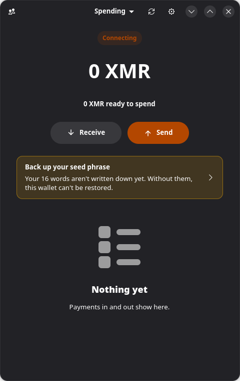
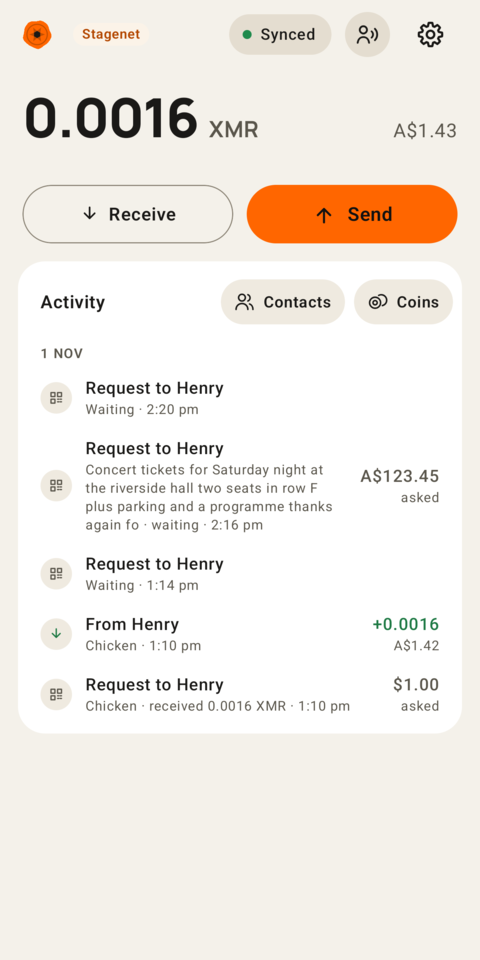
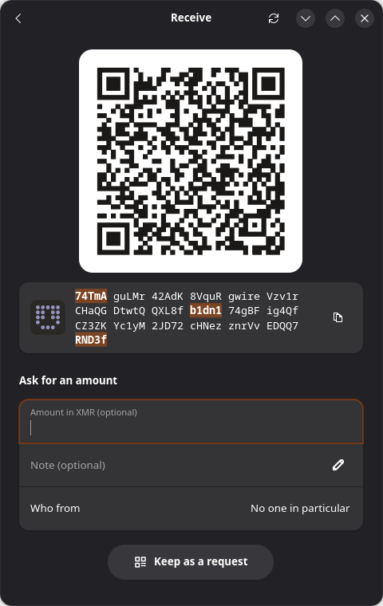
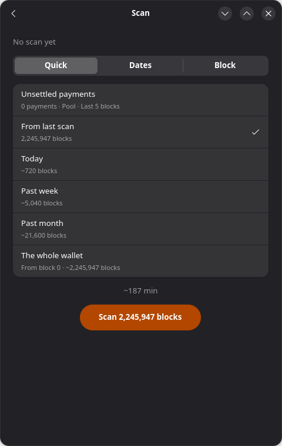
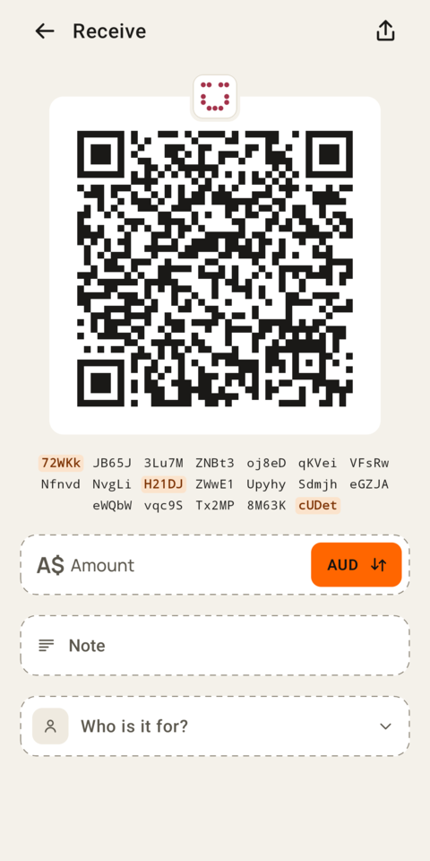

<p align="center">
  
</p>

<p align="center">
  
  &nbsp;&nbsp;
  
</p>

<h1 align="center">Fob</h1>

<p align="center">
  <strong>A small Monero wallet: fast to catch up, simple to pay with.</strong><br>
  One Rust core, drawn natively: GTK 4 and libadwaita on the Linux desktop, Compose on Android.<br>
  It keeps the <a href="https://github.com/openreceiptformat/orf-spec">Open Receipt Format</a> receipts that payment codes can carry.
</p>

<p align="center">
  <a href="https://github.com/OceanEilonwy/monokulo-fob/actions/workflows/rust.yml"></a>
  <a href="https://github.com/OceanEilonwy/monokulo-fob/actions/workflows/android.yml"></a>
  <a href="https://github.com/OceanEilonwy/monokulo-fob/releases/latest"></a>
  <a href="LICENSE"></a>
</p>

<p align="center">
  <a href="#android"><b>Android</b></a> ·
  <a href="#linux-desktop"><b>Linux desktop</b></a> ·
  <a href="https://github.com/OceanEilonwy/monokulo-fob/releases/latest"><b>Downloads</b></a> ·
  <a href="#build-from-source"><b>Build from source</b></a>
</p>

## Why Fob

- **Scans on the GPU.** The [monokulo-8ar](https://github.com/OceanEilonwy/monokulo-8ar) prefilter works out 8·a·R for tens of thousands of transaction keys per Vulkan dispatch, at about half the energy per block of a phone's cores. Only flagged blocks go to monero-oxide's own scanner, and a GPU must pass test vectors, with each wallet's own view key too, before it's trusted; without one, the CPU does the work.
- **Rich contacts.** Each contact has a name, a note, a photo and a send address, and keeps every address they've been paid at, so Activity says who a payment was for. A contact's card lists what you've paid them and what you've asked of them, and "Paid, not saved" offers to save any address you've paid as a contact. Scanning someone's profile code adds them.
- **Hardware wallets.** Keep the spend key on a Trezor Model T, Safe 3 or Safe 5, over USB on the phone and the desktop. One screen walks you through connecting: it draws what the device is showing and says what to do there, and asks the one question Fob has (passphrase or not) before the device would. Fob watches with the view key, and every payment is confirmed on the device's own screen.
- **Syncs and sends through a server, if you want.** Settings can point a wallet at a [monokulo-lws](https://github.com/OceanEilonwy/monokulo-lws) light wallet server (or any MyMonero-style one) and catch up in one request. The server gets the view key and nothing more, and Fob takes nothing on its word: each payment's amount is held to the chain's commitment and its proof of inclusion to a node's block hashes, so a server can't invent or inflate a payment. Payments are built and signed on the phone (or on a Trezor) from the coins it checked; the server gives the fee (capped) and the ring members, and broadcasts the finished transaction.
- **Easy testing.** Fob starts on stagenet, with test coins and nothing to lose; mainnet is a separate wallet one switch away in Settings.
- **Light and fast.** A native app on both platforms, with no web view and one small Rust core. Scan lets you pick how far back to look, from unsettled payments to the whole wallet, and says how long it will take.
- **Receipts.** Payment codes from Monokular's tills carry [Open Receipt Format](https://github.com/openreceiptformat/orf-spec) receipts, and Fob keeps each one with the payment it was for.

<table>
  <tr>
    <td width="33%"></td>
    <td width="33%"></td>
    <td width="33%"></td>
  </tr>
  <tr>
    <td align="center">Receive, with the address grouped to check by eye</td>
    <td align="center">Scan as far back as you need</td>
    <td align="center">Ask in your own currency</td>
  </tr>
</table>

## Install

### Android

Every `v*` tag publishes signed APKs on the
[Releases](https://github.com/OceanEilonwy/monokulo-fob/releases/latest) page, with a `SHA256SUMS` file:

| Your device | Download |
|---|---|
| Almost every phone | `fob-<version>-arm64-v8a.apk`, about half the size of the universal one |
| The emulator and x86 Chromebooks | `fob-<version>-x86_64.apk` |
| Not sure | `fob-<version>-universal.apk`, both in one |

Every release is signed with the same key and the APKs share a version code, so any installs over another
(package `com.monokulo.fob`).

To get updates automatically, add `https://github.com/OceanEilonwy/monokulo-fob` to
[Obtainium](https://obtainium.imranr.dev/), or open
[obtainium://add/https://github.com/OceanEilonwy/monokulo-fob](obtainium://add/https://github.com/OceanEilonwy/monokulo-fob)
on the phone. With three APKs on a release Obtainium asks which; set the APK filter to `arm64-v8a` in the app's
settings to pick the phone one every time. The tag (`v0.1.4`) is the version, as the app's own is. A debug build
you make yourself is a different package and sits beside it.

### Linux desktop

Every `v*` tag also puts two builds for x86_64 Linux on the
[Releases](https://github.com/OceanEilonwy/monokulo-fob/releases/latest) page, in the same `SHA256SUMS`:

| Your system | Download | Then |
|---|---|---|
| Any distribution with Flatpak | `fob-<version>-x86_64.flatpak` | `flatpak install --user fob-<version>-x86_64.flatpak` |
| Debian 13, Ubuntu 25.04, Fedora 42 or later (glibc 2.41+) | `fob-<version>-x86_64.AppImage` | `chmod +x` it and run it |

Flatpak fetches the GNOME runtime from Flathub. Being sandboxed, it keeps wallets in
`~/.var/app/com.monokulo.Fob/data/fob`, so it won't see any you already have until you move them there. The
AppImage needs FUSE and adds no menu entry of its own.

Your wallets are sealed under a passphrase you choose, in `~/.local/share/fob`, and lock after 15 minutes left
alone. A camera isn't used: a code is pasted or read from a picture.

0.1.16 changes how a wallet file keeps each coin's spent state (decision 400) and upgrades a file the first time
it opens it; an older Fob can't open it afterwards. Back up `~/.local/share/fob` (on Android, the app's data)
before the first start.

### Trying it out

Fob starts on **stagenet** (test coins, nothing to lose); Settings › Use mainnet switches to a separate mainnet
wallet. Stagenet coins come from a faucet, for example https://stagenet-faucet.xmr-tw.org.

### A wallet on a Trezor

Restore › **Connect a Trezor** (on the desktop, How › Connect a Trezor (USB)) makes a wallet whose spend key
stays on a Trezor Model T, Safe 3 or Safe 5 (Model One can't hold Monero), plugged in over USB. One screen
walks you through it: Fob looks for the device until it's plugged in, then draws what the device is showing and
says what to do there, counting the steps off at the corner (Unlock, Wallet, Allow, Address; the first two only
when the device has a PIN or passphrase protection). The PIN is entered on the device. Fob asks the one
question of its own before the device would, "Do you use a passphrase?", and No opens the standard wallet with
nothing to type. The device exports the view key, so Fob watches and catches up as usual, and Fob shows the
wallet's address in full for you to check against the device's screen before anything is kept. Without a
restore height Fob scans from the first block, so give the height or date of the wallet's first payment if you
know it. Home says when the device has to be asked for key images, and every payment is confirmed on the
device's own screen.

On Linux the device needs Trezor's udev rules, which Trezor Suite installs, or
[51-trezor.rules](https://data.trezor.io/udev/51-trezor.rules) put in `/etc/udev/rules.d/`. Tried on a real
Safe 3 on the desktop up to the address check, and against the protocol in software for the rest; the Android
screen hasn't been tried on a phone yet. Try it on stagenet first.

## Build from source

The desktop app needs Rust, GTK 4.18 and libadwaita 1.7 or newer:

```sh
git clone https://github.com/OceanEilonwy/monokulo-fob.git
cd monokulo-fob
crates/fob-gtk/install.sh    # builds Fob and adds it to your applications menu
```

`crates/fob-gtk/appimage.sh` and `crates/fob-gtk/data/com.monokulo.Fob.yml` build the AppImage and the Flatpak.

The Android app also needs `cargo-ndk`, the Android SDK (platform 37.2, NDK r27) and a JDK 21 (Android
Studio's: `/opt/android-studio/jbr`):

```sh
cd android && echo "sdk.dir=$HOME/Android/Sdk" > local.properties
JAVA_HOME=/opt/android-studio/jbr ./gradlew :app:assembleDebug
```

The Gradle build compiles fob-ffi for each ABI with cargo-ndk and generates the Kotlin bindings from it, so the
app and the library can't drift.

For working on Fob:

```sh
cargo nextest run --workspace                                   # or cargo test --workspace
cargo build -p fob-gtk && crates/fob-gtk/scenes.sh              # the desktop windows on a headless display
cargo test --release -p fob-wallet --test stagenet_over_http -- --ignored   # against real stagenet nodes
cargo run --release -p fob-wallet --example fetch_speed [node] [blocks]
```

`scenes.sh` takes one picture per window, and its `walk` scene presses through the app as someone would.

### How it fits together

- `crates/fob-wallet` is the whole wallet, in Rust, on monero-oxide: seeds and keys, payment and wallet codes,
  receipts, the encrypted wallet file, syncing and sending.
- `crates/fob-screens`, `fob-codes`, `fob-vault`, `fob-price`, `fob-chain`, `fob-scanner`, `fob-monero` and
  `fob-words` are the parts `fob-wallet` is built from (`docs/decisions.md`, decision 339). `fob-scanner`'s
  prefilter is the `monokulo-8ar` crate, in its own repo, shared with monokulo-lws (decision 366).
  `fob-chain::light` is the light wallet server client (the MyMonero/monero-lws REST API), for syncing through
  a server instead of scanning, and sending through it, Trezor wallets too (decisions 371–397). A coin's spent
  state is one type moved by one exhaustive function (`fob-wallet`'s `wallet/coin.rs`, decision 400), and the
  Trezor screens' words come from `fob-words` so both apps say the same (398).
- `crates/fob-keys` holds a wallet's keys with nothing else (decision 416), and `fob-codes`' `connect.rs` is
  Connect to Fob, with vectors in `crates/fob-codes/vectors/connect-v1.json` (417). Monokular's Till uses
  `fob-wallet` as a library, without its `usb` and `vendored-openssl` features: a receive account, keyed
  requests on a pool of addresses with amount tags, labelled accounts (decisions 415, 418–421).
- `crates/fob-app` is what a client draws: unlocking, the open wallet, syncing.
- `crates/fob-gtk` is the Linux desktop app, in Relm4 and libadwaita.
- `crates/fob-ffi` is fob-wallet for Kotlin (later Swift) through UniFFI, and `android/` the Android app, a thin
  Compose layer over it.
- The seed crates, `monero-seed` and `polyseed`, come from
  [kayabaNerve/monero-wallet-util](https://github.com/kayabaNerve/monero-wallet-util) at a fixed commit, and
  `docs/decisions.md` says why things are the way they are.

Designs: https://claude.ai/artifact/MK3rLvr8rcGa6WA5CZrXat

GPL-3.0.
